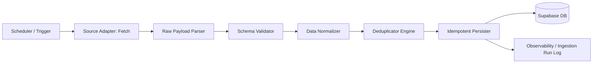

# LaunchPad Data Ingestion Architecture

## 1. Principles & Ethical Standards

Automated opportunity collection is central to LaunchPad's mission. However, collection must be conducted responsibly:
1. **Official APIs & Feeds First:** Prioritize official public APIs, RSS feeds, and authorized partner integrations.
2. **No Bypassing Access Controls:** Never attempt to bypass CAPTCHAs, paywalls, or anti-bot protections. Never scrape private platforms that forbid automated access (e.g. LinkedIn).
3. **Data Quality Over Quantity:** One hundred fresh, verified opportunities are vastly superior to ten thousand stale, dead, or inaccurate records.
4. **Attribution & Transparency:** Always display original source attribution, canonical application links, and the exact timestamp of last verification.
5. **Polite Request Rates:** Enforce per-source rate limiting with exponential backoff and jitter.

---

## 2. Ingestion Pipeline Architecture



### Core Pipeline Stages:

1. **Source Adapter Contract (`SourceAdapter`):**
   - Each external provider implements a uniform TypeScript/JavaScript interface:
     ```typescript
     interface SourceAdapter {
       id: string;                      // e.g. 'devpost-hackathons', 'github-student-pack'
       name: string;                    // Human-readable source name
       sourceType: 'api' | 'rss' | 'partner';
       rateLimitPerMinute: number;
       fetchRaw(cursor?: string): Promise<RawFetchResult>;
       parse(payload: unknown): RawOpportunityRecord[];
       normalize(raw: RawOpportunityRecord): NormalizedOpportunity;
     }
     ```

2. **Schema Normalization:**
   - Converts source-specific properties (e.g. `prizes`, `tags`, `submission_period_dates`) into the canonical `NormalizedOpportunity` model.
   - Cleans and normalizes fields:
     - URL canonicalization (stripping tracking parameters like `utm_source`, `ref`, `fbclid`).
     - Location resolution (e.g. maps "Remote, India" or "Anywhere" to `work_mode: 'remote'`).
     - ISO-8601 UTC timestamp conversion for deadlines and event windows.

3. **Deterministic Deduplication:**
   - Multi-tier matching logic to prevent duplicate records:
     - **Tier 1 (Source + External ID):** Matches `(source_id, external_id)` via unique SQL index.
     - **Tier 2 (Canonical URL):** Matches identical sanitized application destination URLs.
     - **Tier 3 (Company + Title + Deadline Window):** Normalizes company name and title, checking if a record exists within +/- 7 days of the specified deadline.
   - When a duplicate is detected, provenance is preserved, and the most recent verification timestamp is refreshed.

4. **Idempotent Persistence:**
   - Utilizes PostgreSQL `ON CONFLICT (source_id, external_id) DO UPDATE` to update mutable fields (deadline, status, last_verified_at) without creating duplicate primary keys.

5. **Observability & Ingestion Run Logging:**
   - Every execution creates a record in `ingestion_runs`:
     - Records fetched, created, updated, and skipped.
     - Execution duration and status (`running`, `success`, `partial_failure`, `failed`).
     - Detailed structured error logs for invalid or unparseable records.

---

## 3. Recommended First Ingestion Source

### Selected Source: **Devpost Public Hackathons Feed (RSS / Public API)**
- **Source Identifier:** `devpost-hackathons`
- **Source Type:** Public RSS / Structured Feed
- **Endpoint:** `https://devpost.com/hackathons.rss` / public listing endpoint.
- **Rationale for Selection:**
  1. **100% Public & Permitted:** Devpost provides an open RSS feed specifically intended for syndication and event aggregators.
  2. **High Student & Developer Relevance:** Hundreds of student hackathons, worldwide challenges, and competitions with clear deadlines, prize values, and submission rules.
  3. **High Data Fidelity:** Every record provides clear title, host/organizer, start and end dates, registration deadline, eligibility tags, and direct submission URLs.
  4. **Low Operational Overhead:** Does not require authentication or paid API keys, making it ideal for immediate local reproduction and testing by open-source contributors.
  5. **Deterministic Structure:** RSS XML / JSON feeds can be reliably parsed with standard parsers without fragile DOM selectors.

---

## 4. Error Handling & Resilience Rules

1. **Failure Containment:** A failure in one adapter must never abort other active source adapters.
2. **Exponential Backoff:** When HTTP 429 (Too Many Requests) or 5xx server errors occur, retry using exponential backoff with randomized jitter:
   $$t_{wait} = \min(t_{max}, t_{base} \times 2^{attempt}) + \text{jitter}$$
3. **Circuit Breaker:** If a source fails consecutively 5 times, mark the source status as `degraded` and alert via ingestion run logs rather than repeatedly hammering the provider.
4. **Safe Expiration:** A single failed fetch must **never** mark existing opportunities from that source as expired or closed. Expiration is only triggered when the source explicitly reports closure or when an HTTP 404 is confirmed during re-verification.
