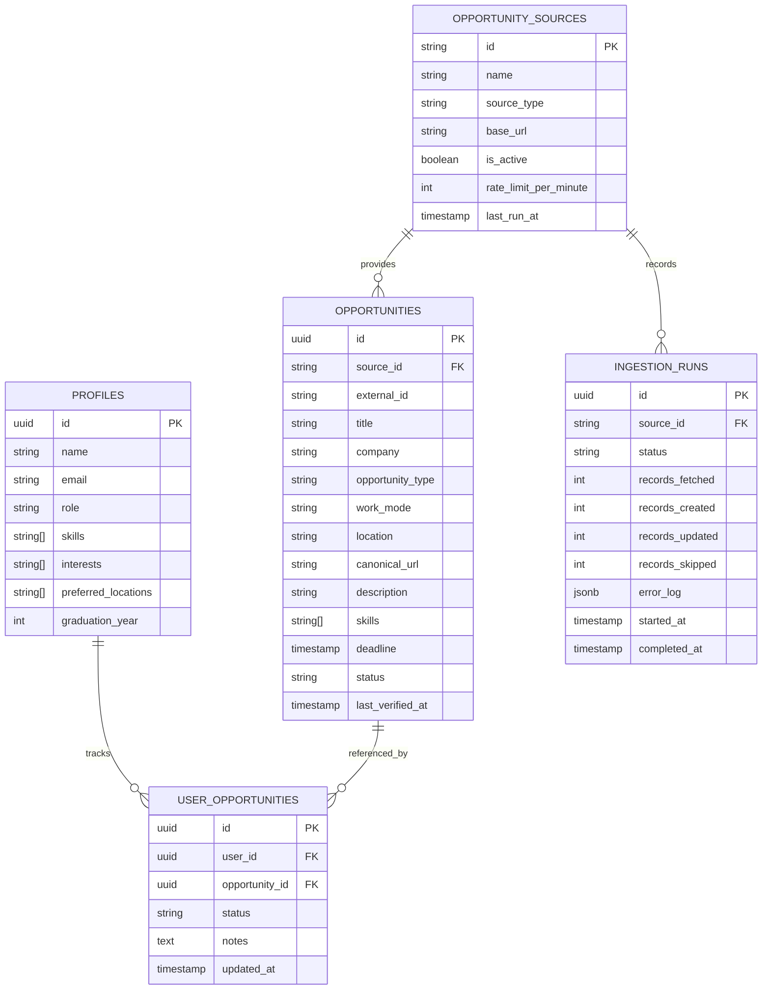
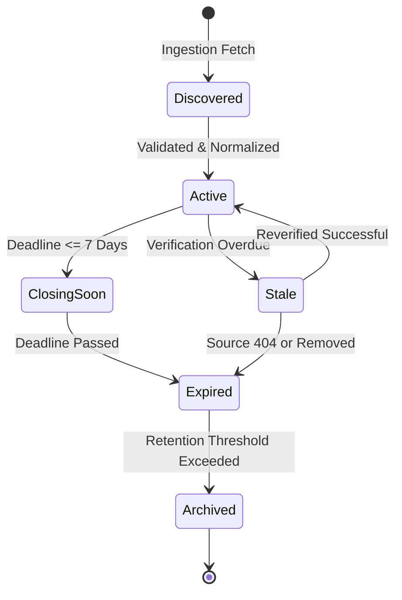

# LaunchPad System Architecture Overview

## 1. Executive Summary & Product Vision

LaunchPad is an open-source, unified opportunity discovery and personal tracking platform designed to eliminate fragmentation for students, fresh graduates, and early-career talent.

The platform aggregates opportunities across multiple categories:
- **Internships & Graduate Opportunities**
- **Full-time & Part-time Jobs**
- **Hackathons & Competitions**
- **Conferences, Meetups & Workshops**
- **Open-Source Programs & Fellowships**

The core design principle is:
> **One platform. Multiple opportunity sources. Reliable discovery. Personal tracking.**

---

## 2. Target Three-Tier Architecture

To achieve high reliability, security, and open-source modularity, LaunchPad adopts a decoupled three-tier architecture:

```mermaid
graph TD
    subgraph Client Tier ["Client Tier (Browser / Frontend)"]
        UI["Web App (React / Vite -> Next.js)"]
        AuthClient["Supabase Auth Client"]
        DataClient["Supabase Client (RLS Protected)"]
    end

    subgraph Platform Tier ["Platform Tier (Supabase BaaS)"]
        Auth["Supabase Auth (JWT & OAuth)"]
        Postgres[("PostgreSQL Database")]
        RLS["Row Level Security Engine"]
        Storage["Storage (Assets / Logos)"]
    end

    subgraph Ingestion Tier ["Ingestion Tier (Scheduled Worker)"]
        Scheduler["Ingestion Scheduler"]
        Registry["Source Adapter Registry"]
        Normalizer["Normalization & Deduplication"]
        WorkerService["Ingestion Runner (Service Role)"]
    end

    subgraph External Sources ["External Data Sources"]
        OfficialAPIs["Official Public APIs"]
        Feeds["RSS / iCalendar Feeds"]
        Partners["Partner Webhooks"]
    end

    UI --> AuthClient
    UI --> DataClient
    AuthClient --> Auth
    DataClient --> RLS
    RLS --> Postgres
    Auth --> Postgres

    Scheduler --> WorkerService
    WorkerService --> Registry
    Registry --> External Sources
    Registry --> Normalizer
    Normalizer --> Postgres
```

### Tier 1: Client Application
- **Responsibilities:** Fast, responsive UI, search and filtering with shareable URL state, user authentication interface, and personal application tracker.
- **Security Constraint:** Operates exclusively using public/anonymous keys. Contains **zero** server-side secrets or `service_role` keys.
- **Data Access:** Communicates with PostgreSQL through Supabase Client with Row Level Security (RLS) guaranteeing data privacy.

### Tier 2: Supabase BaaS (Data & Identity Core)
- **Database:** Managed PostgreSQL containing relational tables, check constraints, foreign keys, and indexes for fast filtering and full-text search.
- **Authentication:** Supabase Auth providing email/password signup, email verification, Google OAuth, session refresh, and token management.
- **Row Level Security (RLS):** Declarative SQL policies enforcing tenant isolation directly at the database engine.

### Tier 3: Ingestion Worker (Background Engine)
- **Responsibilities:** Scheduled fetching from authorized external sources, schema normalization, canonical URL deduplication, stale record detection, and run observability.
- **Privilege:** Runs in a trusted execution environment (Node.js worker or serverless functions) using the privileged Supabase `service_role` key. Public users cannot trigger or manipulate ingestion pipelines.

---

## 3. Trust Boundaries & Security Architecture

1. **Authentication:**
   - Identity is verified through Supabase Auth using cryptographically signed JWTs.
   - `auth.uid()` provides the authenticated principal identifier in all SQL policies.
2. **User Data Isolation (RLS):**
   - Private user records (`profiles`, `user_opportunities`) are protected with strict RLS policies:
     - `auth.uid() = user_id` for tracking records.
     - `auth.uid() = id` for user profile records.
   - Public users can never view, mutate, or delete another user's tracking notes or application stages.
3. **Public Data Protection:**
   - The canonical `opportunities` table is read-only for public and authenticated users.
   - Mutations (INSERT, UPDATE, DELETE) are exclusively permitted by `service_role` via the ingestion worker.
4. **External Content Sanitization:**
   - External descriptions and links are treated as untrusted input. Markdown rendering is sanitized, URLs are validated against allowed protocols (`http:`, `https:`), and `rel="noopener noreferrer"` is enforced on all external links.

---

## 4. Domain Boundaries & Entity Relationship



---

## 5. Opportunity Lifecycle State Machine

Opportunities transition through distinct lifecycle stages based on deadline and verification events:



- **Active:** Verified open opportunity accepting applications.
- **Closing Soon:** Deadline within 7 calendar days.
- **Stale:** Verification interval exceeded without successful refresh; flagged for worker re-check.
- **Expired:** Deadline has passed or source listing removed. Retained for historical tracking.
- **Archived:** Historical record no longer visible in default discovery views.
